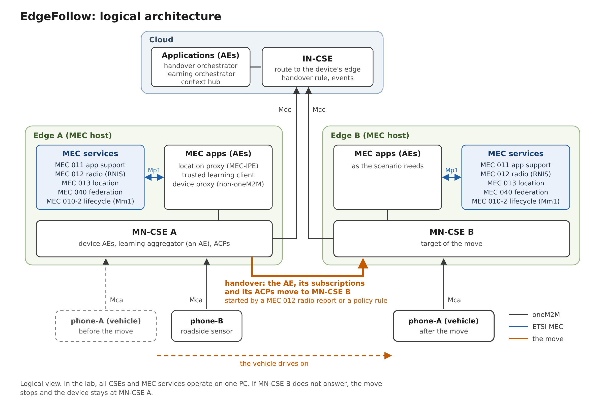

# EdgeFollow: a vehicle's oneM2M data follows it from edge to edge, with ETSI MEC

EdgeFollow moves a device's oneM2M registration, its data, its subscriptions and its access rules from one edge
server to the next when the device moves. ETSI MEC services start and steer the move. In the runs with the real
phones, no sample taken was lost or duplicated; the phone pauses its samples for about 8.7 s during the move.

The project is an entry to the 2026 oneM2M international hackathon (ESTIMED: oneM2M and ETSI MEC). The article
explains the design and the results: https://www.hackster.io/aksingh777a/edgefollow-by-team-aadhya-6a5d62 (a copy is
in `docs/article/ARTICLE.md`).



## What it does

- **Handover with service continuity.** The handover library (`estimed/handover.py`) moves the vehicle's AE from
  MN-CSE A to MN-CSE B with its containers, samples, access control policies and subscriptions, checks the copy,
  and releases edge A only after the IN-CSE routes the vehicle to edge B; if anything fails first, it rolls back and
  the vehicle stays on edge A. The runs with the real phones used the phone driver's own, simpler move
  (`phone/estimed_poc2.py`: the AE, its containers, the reader's policy and one subscription; no rollback).
- **MEC starts and steers the move.** A MEC 012 radio report starts it (in the phone runs at a threshold of
  -44 dBm, so that the first real report fires; the phones did not move). MEC 040 names the target edge. In the
  library path, MEC 011 must list the target MN-CSE as a ready service.
- **ETSI's MEC Sandbox drives it.** `estimed/sandbox_follow.py` polls the Sandbox's MEC 013 every 2 s for a moving
  simulated user and moves the vehicle when it enters the next zone: completed in all 8 network scenarios on
  2026-11-21 (`records/sandbox/`).
- **Two oneM2M implementations.** The move works in both directions between ACME and tinyIoT, and the full MEC
  scenario passes 10 of 10 steps with tinyIoT as edge B (`records/tinyiot/2026-11-21/`).
- **Protocols measured.** The same oneM2M workload over HTTP, HTTPS, WebSocket with and without TLS, MQTT and CoAP
  (six bindings) on one CSE
  (`records/proto/`; the live path itself uses HTTP).
- **TR-0086 deployment options A, C and D** with their own tests (B is the lab itself), and clause 5.2.4.1 (an
  IN-CSE with TLS and Basic auth, an MN-CSE registering over HTTPS) on private CSEs.
- **Federated learning across the edges,** with oneM2M resources for the tasks, the updates and the clients.
- **An agent with two MCP servers** (`estimed/apps/edge_agent/`) that runs the handover through tools and keeps its
  journal in oneM2M.
- **A collision warning that follows the vehicle** (`estimed/apps/vru_warning/`). A warning AE on the edge CSE of a
  crossing warns the vehicle when a roadside sensor reports a pedestrian or a cyclist in its zone and the vehicle is
  approaching. It finds the vehicle's current edge through a route record on the IN-CSE, holds the warning while
  the vehicle is moving, and writes it on the new edge after the move.
- **Privacy rules held by tests.** Each container carries its own access policy list (ACME does not inherit an AE's),
  and the city never receives a coordinate; it does receive the zone and the serving cell, which are cell-level
  location.

## What is real, and what is simulated

| Part | In this repository |
| ---- | ------------------ |
| oneM2M CSEs | ACME CSE 2026.5.3, installed with pip; not copied here |
| MEC services (MEC 010-2, 011, 012, 013, 040, 046) | this project's own Python implementations of the ETSI APIs |
| The phones | an Android app (`phone/probe_app/`) and the drivers that ran it; the four phone runs are published as records |
| Without phones | `phone/sim_phone.py` stands in for the phones; the same drivers run with `--device sim` |
| The warning AE's vehicle and roadside sensor | simulated in its tests (`estimed/tests/test_vru_warning.py`); the phones did not run it |
| ETSI's MEC Sandbox | `estimed/sandbox_follow.py` (needs a sandbox of your own); the runs of 2026-11-21 are in `records/sandbox/` (its address is not published) |

## Folders

| Folder | What is in it |
| ------ | ------------- |
| `estimed/` | the lab: CSE configuration and start scripts, the handover library (`handover.py`), the MEC scenario, the TR-0086 options (`apps/`), the MCP agent (`apps/edge_agent/`), the warning AE (`apps/vru_warning/`), the Sandbox driver, and the tests (`estimed/tests/`) |
| `estimed_poc/` | federated learning, the handover policy, and the device tests (TD_MEC_DEV_02) |
| `phone/` | the phone drivers, the phone-backed MEC services, the simulated phone, the TLS front door, and the Android app |
| `mec010p2/`, `mec011_appsupport/`, `mec012/`, `mec013_look/`, `mec013_sub/`, `mec046/`, `demo/` | the MEC service implementations (`demo/mec040.py` is MEC 040) |
| `docs/` | the reproduce guide, the figures and the article (`estimed/RUNBOOK.md` and `estimed/TESTPLAN_COVERAGE.md` hold the runbook and the TR-0086 coverage table) |
| `records/` | the results the article cites (see `records/README.md`) |

## Paths

This code was developed and run on one lab PC. Its scripts, tests and configuration files use absolute paths of one
layout, published here as:

| Path | What it is |
| ---- | ---------- |
| `/home/edgefollow/edgefollow` | this repository |
| `/home/edgefollow/estimed-venv` | the CSE environment (`requirements/cse.txt`) |
| `/home/edgefollow/edgefollow-lab/.venv` | the lab environment (the quick start below; `requirements/lab.txt` for an exact replica) |
| `/home/edgefollow/estimed-run` | the CSEs' files and the run records |
| `/home/edgefollow/etsi-forge-ats-reference` | a clone of ETSI's MEC test suites (https://forge.etsi.org/rep/mec); a few tests read its JSON schemas |

The layout is fixed: a Linux user `edgefollow`, with the paths above under `/home/edgefollow`. A VM is the easy way
to get it; `estimed/vm_rerun.py` builds such a VM from a Debian 13 cloud image. Some newer tools also read
`EDGEFOLLOW_PY` and `EDGEFOLLOW_RUN_DIR`.

## Quick start (no phones)

```sh
# as the user edgefollow, with this repository at /home/edgefollow/edgefollow (Debian 13: Python 3.13;
# as root once: apt-get install -y python3-venv git). The same steps as estimed/RUNBOOK.md section 2.
python3 -m venv ~/estimed-venv && ~/estimed-venv/bin/pip install -r estimed/requirements.txt
python3 -m venv ~/edgefollow-lab/.venv && ~/edgefollow-lab/.venv/bin/pip install pytest==9.1.1 fastapi==0.139.0 uvicorn==0.51.0
PY=~/edgefollow-lab/.venv/bin/python

bash estimed/run_topology.sh                     # IN-CSE :8200, MN-CSE A :8201, MN-CSE B :8202
EDGEFOLLOW_PY=$PY bash estimed/mec_services.sh start      # MEC 012 :8085, MEC 013 :8101, MEC 040 :8300
$PY -m pytest -q estimed/tests/test_estimed_testplan.py   # the TR-0086 test descriptions on the lab
$PY phone/estimed_poc2.py --device sim           # the handover with a simulated phone
$PY -m pytest -q -m lab estimed/tests/test_edge_agent.py # the MCP agent on the lab (the tests set up the vehicle)
```

`estimed/RUNBOOK.md` gives the full path from a fresh machine to TD_MEC_DEV_01, with the expected test counts.
`requirements/cse.txt` pins the same ACME version as `estimed/requirements.txt`. `requirements/lab.txt` is the complete
version list of the lab environment the records were made with: install it instead of the three packages above for
an exact replica, and for `phone/test_estimed_poc.py` and the attestation checks, which also need jsonschema and
cryptography.
`docs/REPRODUCE.md` lists every number in the article, with the record it comes from and how to reproduce it.
Several test modules run without the lab at all, for example `estimed/tests/test_edge_agent.py -m "not lab"`,
`estimed/tests/test_vru_warning.py --strict-markers -m "not live"` and `phone/test_estimed_poc.py`.

## Results

| What | Result | Record |
| ---- | ------ | ------ |
| Handover with the real phones, 4 runs | all steps passed, 11 controls failed as they must in each run; 0 samples lost or duplicated of those taken | `records/` (sitting B) |
| TR-0086 test plan, 18 test descriptions | 13 covered, 5 partial | `estimed/TESTPLAN_COVERAGE.md` |
| A fresh Debian 13 VM follows the runbook | 142 of 142 tests passed on 2026-11-20; the cleaned code again on 2026-11-21: 142 of 142, onboarding at most 133 s, all five OBS_03 steps PASS | `records/sim/` (vm_rerun) |
| ETSI MEC test suites against our MEC services | 55 suites: 533 passed, 148 failed, 2 not run; by our analysis most failures are in the suites themselves (not confirmed by ETSI), for example MEC 013's `timestamp` vs the specification's `timeStamp` | `records/` (sweep) |
| Handover driven by ETSI's hosted MEC Sandbox | completed in all 8 network scenarios (9 of 10 runs; the tenth correctly did not move) | `records/sandbox/` |
| Handover between ACME and tinyIoT | both directions passed; the full scenario 10 of 10 | `records/tinyiot/2026-11-21/` |
| One oneM2M workload over six bindings | write and notification costs per binding (loopback, one PC) | `records/proto/` |

These are measurements of this project's implementations, not a conformance claim.

## How it is tested

- Each run has **controls**: planted errors that must make a check fail. A run counts only when all its controls
  fail as they must.
- **Planted faults:** for each new part, a copy of the code gets one fault at a time, and the tests must catch each.
- **A second reviewer** checks each part, plants faults of its own, and runs the part again.
- **A skipped test is not a passed test.**

## Limits

- One PC: all CSEs and MEC services run on one machine. The phones send over USB, not over the radio.
- The MEC 012 and MEC 013 services take the radio data and the position that the phone itself reports.
- The learning devices are simulated. The runs do not use the ESTIMED VM.
- The lab CSEs take the originator header as given; TLS with Basic auth is shown on private CSEs only.
- The live path uses HTTP; the other bindings are measured but no device uses them yet.
- The phone driver's own move has no rollback and does not check the IN-CSE's route after the move; the handover
  library does.
- The Sandbox trigger is polled every 2 s, and its users are simulated.
- A move fails, and rolls back, when a container that it copies is full, or fills during the move, and then gets a
  write. The fix belongs in `handover.py` and is not made yet; the warning AE's vehicle therefore writes nothing
  while its route says MOVING.
- The published paths assume the layout above.

## Licences

- Code: Apache License 2.0 (`LICENSE`).
- Documentation, figures and records (`docs/`, `records/`, `*.md`): CC BY 4.0 (`LICENSES/CC-BY-4.0.txt`).
- Third-party projects: `NOTICE`.

## Links

- oneM2M: https://www.onem2m.org/ · developers: https://www.onem2m.org/using-onem2m/developers
- ESTIMED: https://estimed.etsi.org/
- ACME oneM2M CSE: https://github.com/ankraft/ACME-oneM2M-CSE · tinyIoT: https://github.com/seslabSJU/tinyIoT
- ETSI MEC Sandbox: https://try-mec.etsi.org/
- ETSI MEC: https://www.etsi.org/technologies/multi-access-edge-computing
