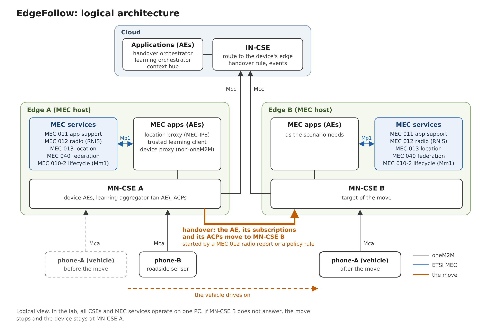
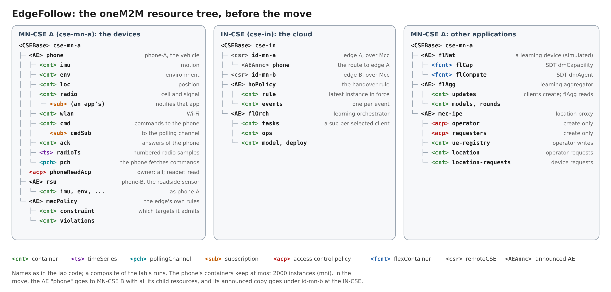
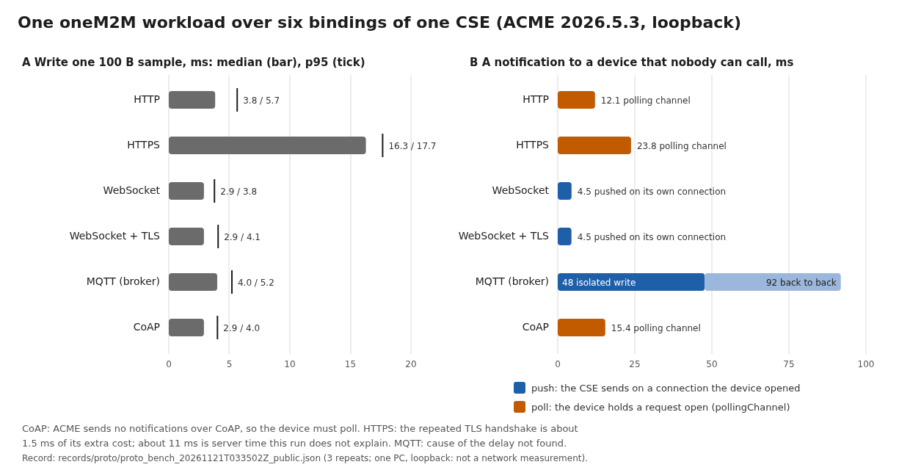
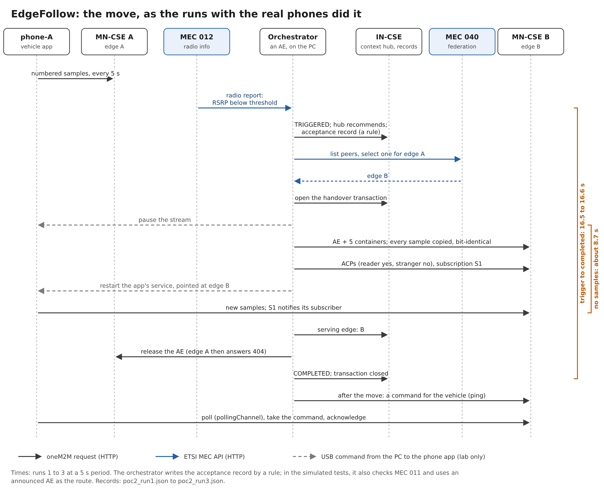
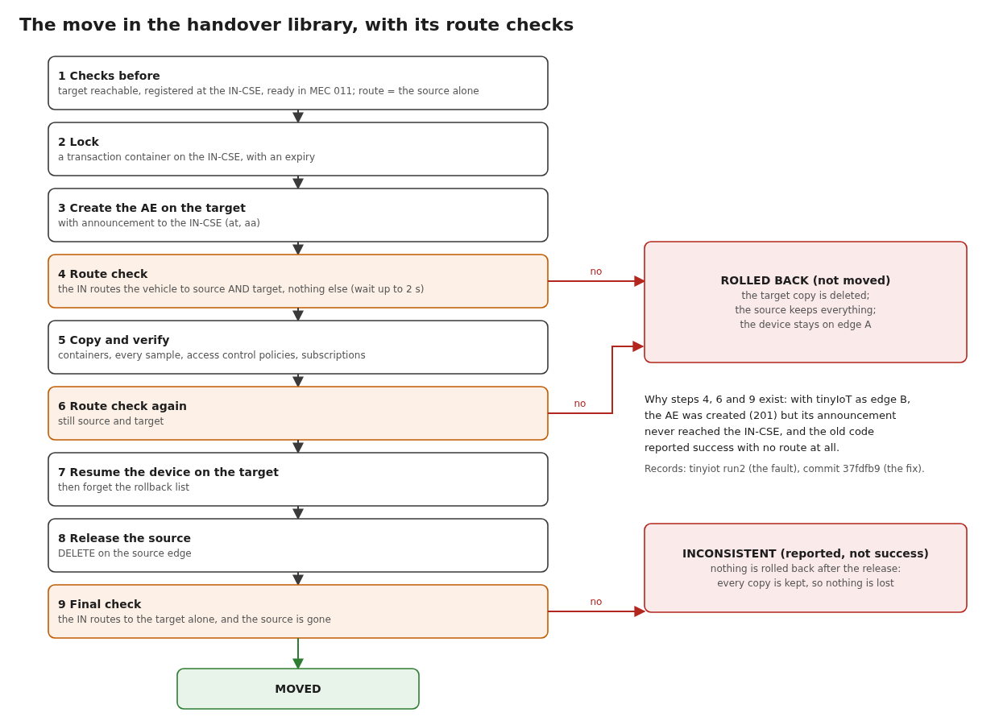
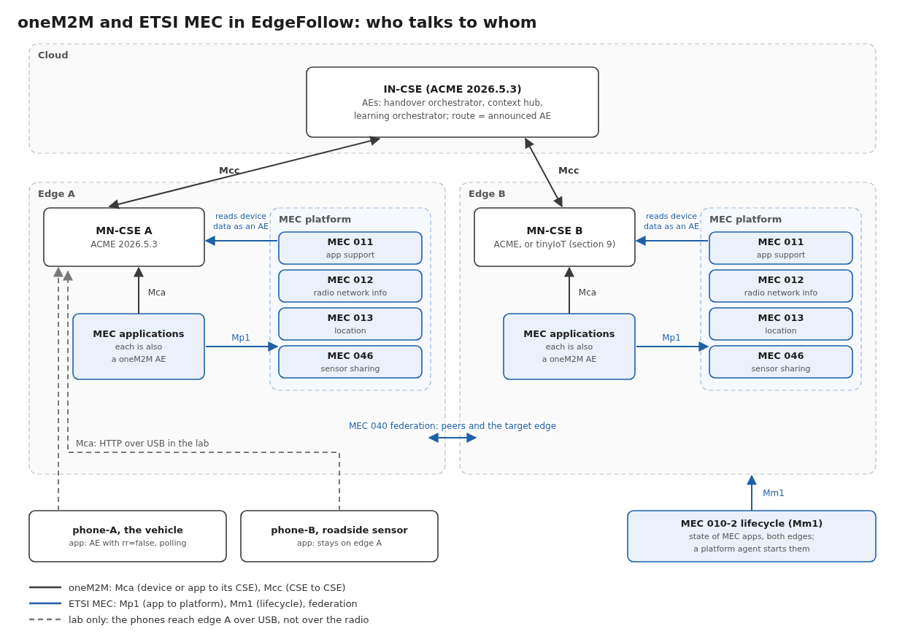
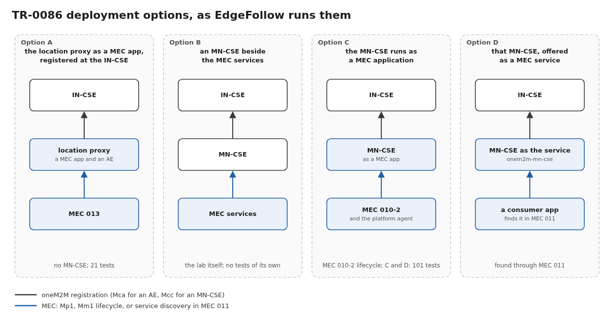
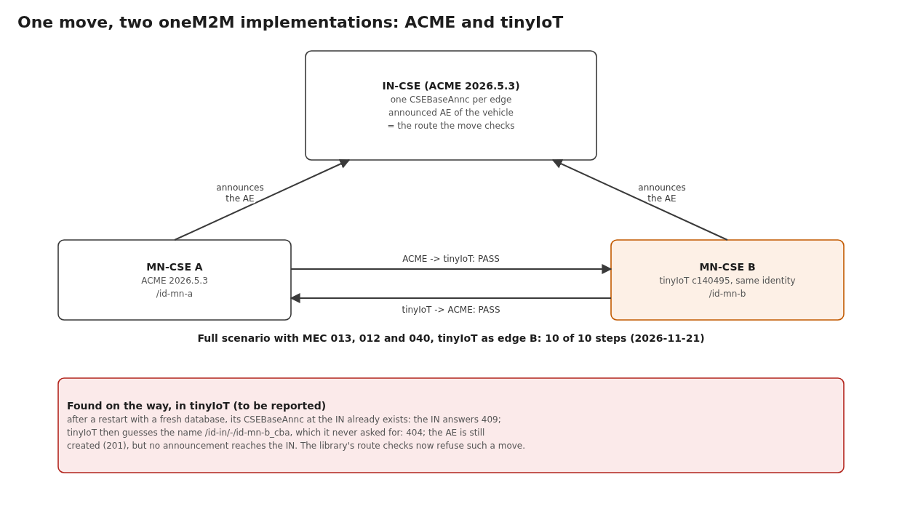
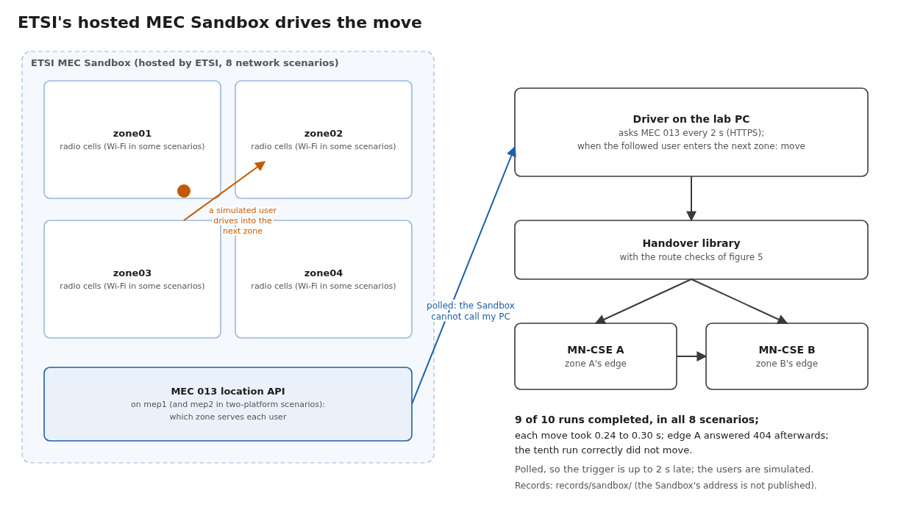

# EdgeFollow: a vehicle's oneM2M data follows it from edge to edge, with ETSI MEC

EdgeFollow moves a device's oneM2M registration, subscriptions and access rules from one edge server to the next. A
MEC radio report or a policy starts the move. Privacy is a design goal from the start. The data stays near the
device, and each party sees only what it needs. Each claim below rests on a test that can fail.

> **Results in short.** With two real phones, the move took 16.5 s at a 5 s sample period, and no sample taken was
> lost or duplicated (4 runs, section 8). ETSI's hosted MEC Sandbox drove the move through 8 of its network scenarios
> (section 11). The move works in both directions between two oneM2M implementations, ACME and tinyIoT (section 9).
> The same oneM2M workload was measured over HTTP, HTTPS, WebSocket, MQTT and CoAP (section 7).

I chose oneM2M because it already has the parts that a move needs: one resource tree from the cloud to every edge, an
access control policy on every resource, subscriptions, a polling channel for a device that nobody can call, and
announcement, which tells the cloud which edge serves a device (section 14).

## 1. Why EdgeFollow

I started EdgeFollow with one picture in my head: a car drives along a road, and its data drives with it.

A connected vehicle sends its data to a server near the road, an edge server. The edge server is near the radio cell,
so the delay is short. When the vehicle moves, a different edge server becomes nearer. Then the vehicle data must go
there. The applications that use the data must not stop. The access rules must stay the same. And nobody may open the
data to make the move.

oneM2M gives one resource tree from the cloud (the IN-CSE) to each edge (an MN-CSE). Each resource has an access
control policy. ETSI MEC gives the edge information about the network, such as radio quality (MEC 012) and location
(MEC 013). It also manages applications on the edge: MEC 010-2 keeps their lifecycle state, and MEC 011 says when
they are ready (in my lab, a small platform agent starts the processes). Together, they can find when a device must
move, and to which edge.

For me, the interesting part was the move itself. Moving a registration is easy. Moving it without losing a single
notification, without opening a single access rule, and with a way back when the new edge does not answer: that is
where the work was.

*Terms used: a CSE is a oneM2M server (IN-CSE in the cloud, MN-CSE on an edge). An AE is an application or device
registered on a CSE. Mca links an AE to its CSE; Mcc links two CSEs. MEC applications use MEC services over Mp1;
MEC 010-2 is a lifecycle API on Mm1. An ACP is an access control policy. `rr` says whether a CSE can call an AE, and
`mni` limits the number of instances in a container. SDT is the oneM2M information model of TS-0023. CMDH is the
oneM2M policy resource for message delivery.*

## 2. Use cases

**Road safety at a crossing.** The ESTIMED use cases describe an autonomous vehicle that enters a new area. The IN-CSE then gives the work to a nearby MN-CSE. That MN-CSE collects real-time data from local sensors and smartphones, and warns about collisions with pedestrians and cyclists. EdgeFollow builds the step that this needs. The vehicle's oneM2M context moves to the nearby MN-CSE with its subscribers and its access rules. This happens before the warnings must flow.

**A roadside sensor that shares context, not positions.** A roadside sensor stays at one edge. A context hub on the IN-CSE combines derived values from the sensor and the vehicle. These are signal quality, zone and the number of Wi-Fi access points. It never uses positions. The hub recommends a move. A decision record for the vehicle must accept the recommendation before the move starts.
In the lab, the PC writes this record by a rule; an agent on the phone is a next step.

**Learning across edges without moving the data.** Devices at the edges train a small model on their own data. Only
model updates travel. My model estimates the next battery temperature of a device from its temperature and the charge
that it used. The model is small on purpose: every aggregate can be checked bit for bit.

The second ESTIMED use case, ships that approach a port, has the same pattern. The cloud gives time-critical work to the edge near the ship. I did not build it, but the move of EdgeFollow fits it without change.

## 3. Privacy goals I kept in focus

From the first day, I wrote down what the system must not know, as well as what it must do. These goals shaped the
design. Each one has a test.

| Goal | How EdgeFollow keeps it |
| ---- | ----------------------- |
| The samples stay near the device | A phone's samples stay on its edge. The cloud gets the route, events and derived values, not the samples |
| A move carries as little as possible | A rule decides how much history moves: none, the newest record, or all. Each container keeps at most 2000 instances |
| The owner decides who reads | Consent is an entry in an access control policy. When the owner removes the reader from `loc`, the reader gets "403" and each MEC service sees no position |
| Context instead of position | The context hub gets signal, zone and Wi-Fi counts, never positions. The zone and the serving cell are still cell-level location, and the hub keeps them |
| A device asks only for itself | The location proxy accepts a request only from the device that it names. Only the operator registers network identities |
| Learning without sharing data | Clients may only create updates. Only the aggregator reads them, and no client reads another client's update |
| No identifiers in the results | Location results are scanned for coordinates and device identifiers. Run texts name the phones phone-A and phone-B. The raw handover records still hold the real serving cell, so they are scrubbed before they are published |

The same goals applied to my own work on the lab. Before each run with the phones, a written page fixed what the run
may record. Serial numbers, network names, MAC addresses and positions go into no export. The lab Wi-Fi network has
no internet. The plan for the lab TLS key allows one key, for one day and one address.

Privacy turned out to be mostly about what you leave out. Every field that I did not copy is one I never have to
protect.

## 4. What I built



*Figure 1. Logical architecture. In the lab, all CSEs and MEC services operate on one PC. Phone-A is the vehicle;
phone-B is a roadside sensor.*

The cloud has one IN-CSE with three applications: the handover orchestrator, the context hub and the learning
orchestrator. Each edge has an MN-CSE, MEC services and MEC applications. Each MEC application is also a oneM2M AE.
Two phones are the devices: phone-A is the vehicle, and phone-B is a roadside sensor that stays on edge A.

The scenario, step by step:

1. Phone-A registers its AE on MN-CSE A. Every 5 seconds, it sends a sample of motion, environment, position, radio
   and Wi-Fi data.
2. An application subscribes to the radio data of phone-A.
3. MEC 012 reports that the signal of phone-A stays below a threshold for the hold time.
4. The context hub recommends a move to edge B. A decision record for phone-A accepts it. In the lab, the PC writes
   this record by a rule.
5. MEC 040 (federation) lists the peer systems and selects edge B.
6. The PC creates the AE again on MN-CSE B, with its containers, the reader's access control policy and the
   subscription of step 2. A container on the IN-CSE records the new serving edge. The PC then tells the phone app
   over USB to send to MN-CSE B.
7. The orchestrator releases the AE on MN-CSE A. No record of the vehicle stays there.

The runs with the real phones used this path. It has no rollback of its own (section 15).

The handover library has a second path, which the simulated tests, the Sandbox runs and the agent use. It copies the
AE with all its containers, access control policies and subscriptions, checks the copy, and rolls back if anything
fails, so the device stays on edge A. It also checks two things first. MN-CSE B must be registered at the IN-CSE, and
MEC 011 must list it as the service `onem2m-mn-cse`. An announced AE at the IN-CSE then serves as the route, and
the move counts only when the IN-CSE routes the vehicle to edge B alone (section 8).

## 5. Hardware

| Part | Role |
| ---- | ---- |
| Google Pixel 10a (phone-A), Android 17 | the vehicle; real cellular radio data |
| Nothing A142 (phone-B), Android 16, no mobile service | the roadside sensor; motion, environment and Wi-Fi data |
| Lab PC: Intel Core i7-6700HQ, 15 GB RAM, Kali Linux | the IN-CSE, both MN-CSEs and all MEC services; ACME CSE 2026.5.3 |
| USB hub and cables; a USB Wi-Fi adapter | connect the phones; a closed lab Wi-Fi network without internet |

A small Android app that I wrote runs on each phone. It reads the sensors, registers an AE and sends its samples over
HTTP. In the lab, the data goes through the USB cable, not through the radio. The radio data in the samples is real.
The road in my lab is about one metre of cable, and section 15 says so.

Software on the PC: ACME CSE 2026.5.3 for the IN-CSE and both MN-CSEs; tinyIoT (commit c140495) as a second CSE for
edge B (section 9); ETSI's hosted MEC Sandbox for the network-driven moves (section 11); and mosquitto 2.1.2, a
private broker used only for the protocol measurement (section 7).

## 6. oneM2M resource design



*Figure 2. The oneM2M resources of the lab before the move. Names are as in the lab code.*

| Resource | Why it is there |
| -------- | --------------- |
| One AE per device, `rr=false` | a phone on a mobile network has no public address, so the CSE must not call it (on edge B, the PC makes the AE first; the app sets `rr=false` when it attaches) |
| One container per data stream, `mni` 2000 | each sample is one content instance; the storage on the edge has a limit (on edge B, the PC makes the containers with a limit of 5000) |
| A time series, `radioTs` | each radio sample has a sequence number from the phone, so a move can count lost and duplicated samples |
| A polling channel and `cmdSub` | the phone fetches its commands with a long poll; it answers in `ack` |
| Subscriptions of applications | one notification for each new sample; they move with the container |
| Access control policies | the owner may do all; the reader may only retrieve and discover; others get nothing |
| Announcement to the IN-CSE | in the simulated handover tests, the label `aei:<originator>` tells the IN-CSE which edge serves the device; the phone runs record the serving edge in an IN-CSE container |
| Policies as containers | `hoPolicy/rule` holds the rule in force and its history; each edge publishes its own constraint |
| flexContainers with SDT classes | a learning device describes itself with dmCapability and dmAgent from TS-0023; labels let the orchestrator find it |

This was my favourite find in the standard: the orchestrator's route needs no new resource type. An announcement and
a label are enough. Other applications need more on ACME, because only the orchestrator could read the announced AE;
the warning AE of section 8 therefore reads a route record.

## 7. How the parts talk

In the lab, all live oneM2M traffic uses HTTP: Mca between devices or applications and their CSE, Mcc between the CSEs. MEC applications
use the MEC services over Mp1 (REST with JSON). The lifecycle API, MEC 010-2, is a management interface (Mm1). This is how phone-A registers:

```
POST /cse-mn-a HTTP/1.1
X-M2M-Origin: C<the phone's originator>
X-M2M-RI: q<a new number for each request>
X-M2M-RVI: 4
Content-Type: application/json;ty=2

{"m2m:ae": {"rn": "phone", "api": "Nprobe.phone", "rr": false, "srv": ["4"]}}
```

The CSE answers `201 Created` with the result code `2001`. The access control policies use `X-M2M-Origin`.

For a real network, EdgeFollow has a TLS front door. It uses TLS 1.3 with a lab certificate authority. It binds each
phone address to one originator and one AE. It lets through only the request types of the app. It refuses the
administrator originator and requests that the CSE would forward elsewhere. 139 tests check it, 91 of them controls (run again on 2026-11-20).
Its run over the air is the next step.

The front door taught me the most in this project. A CSE trusts the `X-M2M-Origin` header that it receives. So the
door in front of it must check that header, and where each request may go.

### Which protocol for which party: measured

HTTP is a choice, so I measured the alternatives. The same oneM2M workload ran against one ACME 2026.5.3 over each
binding that ACME offers: an AE, a container, 40 content instances of 100 B and 4 KB, a read of the latest one,
a discovery, and a subscription with its notification. Each ran three times, interleaved, on one PC over loopback.

| Binding | Write, 100 B: median / p95 | Bytes per write, to / from the CSE | Notification | Without inbound reachability |
| ------- | -------------------------- | ---------------------------------- | ------------ | ---------------------------- |
| HTTP | 3.8 / 5.7 ms | 390 / 654 | 6.8 ms, needs a receiver the CSE can call | polling channel: 12.1 ms |
| HTTPS | 16.3 / 17.7 ms | 2,152 / 3,116 | 17.9 ms, needs a receiver | polling channel: 23.8 ms |
| WebSocket | 2.9 / 3.8 ms | 282 / 514 | 4.5 ms, on the device's own connection | not needed |
| WebSocket over TLS | 2.9 / 4.1 ms | 306 / 537 | 4.5 ms, on the device's own connection | not needed |
| MQTT, through a broker | 4.0 / 5.2 ms | 325 / 560 | 48 ms after an isolated write; 92 ms when writes follow each other | not needed |
| CoAP | 2.9 / 4.0 ms (4 KB: 10.5 ms, see the note) | 246 / 425 | not delivered | polling channel: 15.4 ms |

*Record: `records/proto/proto_bench_20261121T033502Z_public.json`. Bytes are payload at a counting proxy, without IP and TCP
headers. Loopback on one PC: these are costs of the protocols and of ACME, not of a network. WebSocket with TLS:
8 of 1,152 connections got no answer to their opening handshake for 10 s (0 of 1,152 without TLS); they are left
out of the times. CoAP 4 KB: my client sent the block-wise follow-ups without repeating the request's options, as
RFC 7959 asks, so that figure is slightly low.*



*Figure 3. Left: the cost of one write. Right: how a command reaches a device that nobody can call. Blue is a push on
a connection that the device opened; orange is the polling channel. Same record as the table.*

What the numbers say for my phone. It has no public address, so the CSE cannot call it. Over HTTP it must hold a
polling request open, and each command costs a poll. Over WebSocket it keeps one outbound connection, and the CSE
pushes on that connection in 4.5 ms. A write over WebSocket with TLS took 2.9 ms on a kept connection (5.3 ms with a
new connection each time), against 16.3 ms over ACME's built-in HTTPS server. That server closes each connection, so
every HTTPS request repeats the TLS handshake, but the handshake is only about 1.5 ms of the difference; about 11 ms
more is server time that this run does not explain. MQTT also needs no inbound route. Its notifications took about
48 ms after an isolated write and about 92 ms when writes followed each other, and then each write's own answer
also slowed to about 48 ms. Nagle's algorithm is on in both ACME's MQTT client and the broker's defaults; I have not
found the cause. ACME cannot send notifications over CoAP. So for a device behind NAT, WebSocket with TLS is the
measured fit, and HTTP stays right for the applications on the PC, which can be called. The phone app still uses HTTP
with a polling channel; moving it to WebSocket is a next step.

The measurement found one defect in ACME: its WebSocket server sometimes handled a frame twice (28 duplicate answers
in 24 workloads). Its receive loop hands each frame to a worker through a function that reads the frame only when
the worker runs. I will report it.

## 8. CSE handover with service continuity

The orchestrator does not move to an edge that it cannot reach. The name of the AE on the target must be free or
belong to the vehicle. So a move cannot take over the AE of another originator. The subscriptions are made on
MN-CSE B before the switch. After the release, edge A holds no record of the vehicle. During the switch, the phone
takes no samples. The PC restarts the app's service and points it at edge B. The app's counter then starts again at 0.



*Figure 4. The move, step by step, as the runs with the real phones did it. Dashed grey arrows are USB commands from
the PC; they exist only in the lab. In a real network, the phone must learn its new edge over the air, for example
from a command at edge A just before the release. That part is not built yet.*

These values come from four runs with the real phones in one sitting on 2026-11-19 (app version 19). Each run passed
all its steps, and all 11 controls in each run failed as they must.

| Run | Sample period | Trigger to completed move | Notification gap | Command answered at the new edge | Samples lost / duplicated, of those taken |
| --- | ------------- | ------------------------- | ---------------- | -------------------------------- | ------------------------- |
| 1 | 5 s | 16.52 s | 8.72 s | ≤ 0.51 s | 0 / 0 |
| 2 | 5 s | 16.59 s | 8.70 s | ≤ 0.51 s | 0 / 0 |
| 3 | 5 s | 16.61 s | 8.70 s | ≤ 0.51 s | 0 / 0 |
| 4 | 1 s | 9.17 s | 4.60 s | ≤ 0.51 s | 0 / 0 |

*Records: `poc2_run1.json` to `poc2_run4.json`; summary in `phone/SITTING_B_2026-11-19_SUMMARY.md`. The command was
posted from the PC under the vehicle's own originator. The PC checks for the answer every 0.5 s, so 0.51 s is an
upper bound, which is why it is the same in every run. The notification gap is mostly the time without samples:
about 8.7 s at a 5 s period and 4.6 s at a 1 s period.*

Of the samples taken, zero lost and zero duplicated in all four runs is the number I am proudest of. But I must be clear about the
trigger. The threshold was -44 dBm, a value nobody would use on a road. I chose it so that the first real radio
report starts the move, because the phones sat still on my desk. The runs show the mechanism, not a car that drives
out of a cell.

When the target fails, the move rolls back. A test makes the registration at edge B fail. Then the AE stays on
MN-CSE A, and edge B has nothing of it. A command sent afterwards still reaches the device. A policy test also checks
a conflict between the handover rule and the constraint of an edge. Then no move starts, and the IN-CSE keeps one
diagnostic event. The device keeps working. Both tests use a simulated device.

A second implementation taught me one more check. With tinyIoT as edge B (section 9), a move once reported success
while the IN-CSE could no longer reach the vehicle at all: tinyIoT had created the AE, but its announcement to the
IN-CSE had failed without an error. Since 2026-11-21 the library releases the source only after the IN-CSE routes the
vehicle to both edges, and it counts a move as done only when the IN-CSE routes it to the target alone and the source
is gone. Otherwise it rolls back before the release, or reports the move as inconsistent after it and keeps every
copy. Six lab tests and sixteen offline tests check it; each new test fails on the earlier code. A reviewer found
one more fault on the way: a lost answer to the release could make the rollback delete the target's copy, the only
one left. That is fixed too.



*Figure 5. The move in the handover library. The three orange steps read the route at the IN-CSE. Before the
release, any failure rolls back and the source keeps everything; after it, nothing is rolled back, so no copy is ever
lost. Records: the tinyIoT run that showed the gap, and the commit with the fix and its tests.*

### A collision warning that follows the vehicle

Section 2 asks for warnings at a crossing. A warning AE gives them, at whichever edge serves the vehicle. It runs on
the MN-CSE of the crossing, as its own AE with its own originator. It reads two derived records, each through an
access control policy that names it. The roadside sensor says whether a road user is present, of which class, and in
which zone. The vehicle says its zone and whether it approaches. When a pedestrian or a cyclist is present in the
zone, the vehicle approaches it, and both records are at most 2 s old, the AE writes one warning into the vehicle's
`cmd` container. The warning names the zone, the class of road user, when the sensor saw it, when it was issued and
when it expires. It holds no position, and the AE never reads one.

The hard part was the move. The AE never guesses where the vehicle is. Before each write, it reads a route record on
the IN-CSE. The handover driver keeps that record: it copies what the IN-CSE's announced AE names (section 4), and
during a move it writes MOVING and repeats it every 2 s. The AE writes only to the one edge that the record names, and
only after it checks that the AE under the vehicle's name there has the vehicle's AE-ID. While the record says MOVING,
a warning waits. During the move, the vehicle keeps reading its warnings, but it writes nothing until the record names
an edge again; section 15 says why. A MOVING record older than 10 s means that the driver died inside a move: the
vehicle then writes again, and the AE keeps holding the warning and logs why. A warning lives 3 s from the sensor
event; after that, the AE does not write it and the vehicle does not act on it. The route record exists because of a
measurement: on ACME 2026.5.3, no other originator could read the announced AE at the IN-CSE.

99 tests check it, with a simulated vehicle and a simulated roadside sensor. 70 run without the lab: the rule, the
record shapes, the route record and its keeper, and the AE against an in-memory CSE. 29 run on the lab and move the
vehicle between edge A and edge B while the AE runs. One of them sends ten warnings before a move and ten after, and
each must be acknowledged at the serving edge within one second of the sensor event. In the last such run, the times
were 54 to 142 ms before the move (median 79 ms) and 62 to 157 ms after it (median 123 ms); the move took about 1 s.
Another test moves a vehicle that holds 1,400 samples while it keeps updating its context. In three runs that move
took 28 to 42 s and succeeded, because the vehicle saw MOVING all the way through. These times are printed by
`estimed/tests/test_vru_warning.py`; they are not kept as records, so run the test to see them. The controls include these: after
the move, no request goes to the vehicle on edge A; while the record says MOVING, nothing is written anywhere; an
impostor under the vehicle's name gets nothing; a warning past its time never reaches the new edge; the AE can read no
history and write nowhere but `cmd`. An independent reviewer checked it in several rounds and planted faults each time;
every fault that slipped through became a test or a stated limit.

Its stated limits:

- A warning in flight during a move can appear twice in the new edge's `cmd`: the carried copy and a rewrite. The
  vehicle answers each warning once.
- Anyone can take the route record's name on the IN-CSE first. The driver then cannot open the route, and the
  warnings wait; they never go to a wrong edge.
- One driver per route. A second driver of the same route is not supported and not detected.
- The vehicle's grant lets the AE read the vehicle's whole AE resource: `aa`, `acpi`, `aei`, `api`, `at`, `ct`, `et`,
  `lbl`, `lt`, `pi`, `ri`, `rn`, `rr`, `srv` and `ty`, and `poa` if a vehicle has one. A rule for one attribute
  would, on ACME 2026.5.3, also let strangers read it on every edge, and so learn which edge serves the vehicle.
- The AE can read the vehicle's last acknowledgements: their warning ids and times (the simulated vehicle keeps 8).
- If the driver's MOVING updates fail three times in a row, the record goes stale during the move. The vehicle then
  writes again, which can make the move fail and roll back. Two failures in a row are covered.
- After a move, the carried warning has no expiry time on the CSE, because the handover copies only the content and
  its format. The vehicle's own check of the time still holds.
- The vehicle and the sensor are simulated. The phones did not run it.

## 9. oneM2M and MEC together



*Figure 6. The reference points. oneM2M: Mca links a device or an application to its CSE, Mcc links the CSEs. MEC:
Mp1 links a MEC application to its platform, Mm1 is the lifecycle, and MEC 040 joins the two MEC systems. Each MEC
application is also an AE, and the MEC services read the device's data through oneM2M as AEs.*

| MEC service | How it meets oneM2M |
| ----------- | ------------------- |
| MEC 012, radio network information | reads the `radio` container of the phone; its reports start the move |
| MEC 013, location | reads the `loc` container; the location proxy writes positions back for a device that asks |
| MEC 011, application support | each MEC application is also an AE; an MN-CSE can be the service `onem2m-mn-cse` |
| MEC 010-2, application lifecycle (Mm1) | holds the lifecycle state of AEs, the location proxy and an MN-CSE as MEC applications; my platform agent starts the processes |
| MEC 040, federation | lists the peer systems; in the phone runs, it selects the edge for the move |
| MEC 046, sensor sharing | reads the phone through the reader's access control policy, and works both ways: a change of the sampling rate in MEC 046 becomes a command in the phone's `cmd` container, the phone acknowledges in `ack`, and its next records come at the new rate (phone-B, record `mec046_1.json`) |

One honest note: my lab has no real network. My MEC 012 and MEC 013 take the radio data and the position that the
phone reports into oneM2M. The interfaces are the ETSI MEC interfaces; the source is the phone.



*Figure 7. The four deployment options of TR-0086, with the parts EdgeFollow uses for each.*

TR-0086 names four deployment options. EdgeFollow has tests for A, C and D; B is the lab itself:

- A: the location proxy as a MEC application at the IN-CSE, with no MN-CSE (21 tests).
- B: the lab itself, with MN-CSE A and MN-CSE B beside the MEC services.
- C: an MN-CSE that MEC 010-2 starts as a MEC application.
- D: that MN-CSE offered as a MEC service, which another application finds through MEC 011.

Options C and D have 101 tests together. They use a private IN-CSE, so the lab itself is never touched.

In each test, the lifecycle state comes from MEC 010-2 itself. A reviewer showed me why: an early test still passed when the start call was left out.

Annex A of TR-0086 also runs, as 20 test cases with a simulated gas and temperature sensor. They cover:

- an access policy for each container;
- a command subscription that the CSE verifies first (`vrq`);
- a `<group>` whose `fopt/la` returns the latest reading of every member in one request;
- the HEATER command, which reaches the device.

### An agent with two MCP servers

The handover can also be run by an agent that reaches oneM2M and MEC only through tools. Two small MCP servers
offer them. The oneM2M server has six tools: the edges, where the vehicle is, whether an edge is a valid target,
the move, and a journal. The MEC server has two: the MEC 040 peers and the MEC 011 readiness check.

The agent asks MEC 040 for the peers and keeps only a peer that the IN-CSE also holds. It checks readiness in
MEC 011 and calls the move once. Then it reads the CSEs again, because it does not trust the move's own answer. Each
step goes into a journal on the IN-CSE. So after a crash, the agent continues from the journal, and it never moves a
vehicle twice.

The tools take names from closed lists, never a URL or an originator. The server holds the rules, for any caller. It
reads the source of a move from the CSEs, not from the caller. It accepts a target only when MEC 011 lists it as
ready. It allows one move per run id. And it writes MOVING, MOVED and MOVE_FAILED itself; no caller can write those
states. A language model can use the same eight tools under the same rules, but this agent decides by fixed rules.
121 tests run without the lab and 3 on the lab. The vehicle is the simulated one; the runs with the real phones used
the driver of section 8.

### Other implementations: tinyIoT and ETSI's MEC Sandbox



*Figure 8. tinyIoT as MN-CSE B, under the same identity, behind the ACME IN-CSE. Each edge announces the vehicle's AE
to the IN-CSE, and that announcement is the route the move checks.*

The move should not depend on one CSE. On 2026-11-21, tinyIoT (commit c140495) took the place of MN-CSE B under the
same identity, behind the same ACME IN-CSE, with the current code. The vehicle moved from ACME to tinyIoT and back,
and the full scenario with MEC 013, MEC 012 and MEC 040 passed 10 of 10 steps with tinyIoT as edge B. The IN-CSE
found the vehicle through tinyIoT's own announcement. The same runs found a fault in tinyIoT: after a restart with a
fresh database, it addresses its existing announcement record at the IN-CSE by a name it never asked for, so its
announcements fail without an error. I will report it. It also showed the gap in my own check that section 8 now
closes.

My MEC services are my own, so I compared them with ETSI's. The hosted MEC Sandbox offers 8 network scenarios. In
each, I called every GET endpoint that its API descriptions list without parameters, and sent the same requests to my
services. Of 38 endpoints, 25 answer on both sides. 7 answer only on mine; on the Sandbox they return 501, 404 or
400. 3 answer on neither. 3 answer only on the Sandbox, and they are gaps of mine: MEC 040 subscriptions, and two
access-point routes of MEC 013 that exist in another of my candidates but not in the location service EdgeFollow
runs. The same comparison found that this location service had no zone list; it has one now.

*Records: `records/tinyiot/2026-11-21/` and `records/sandbox/`. The Sandbox runs are on ETSI's scenarios, so I cannot
change their conditions, and its address is not published.*

## 10. Federated learning across the edges

The orchestrator (on the IN-CSE) writes a task, with one subscription for each selected client. Each client trains
on its own data and writes an update. The aggregator (on MN-CSE A) calculates an integer federated average, and a
second method must give the same result. The orchestrator then publishes the new model. Clients join in three ways:

- a learning device with SDT profiles,
- a trusted client that trains for two simple sensors from two different administrative domains,
- a device outside oneM2M behind a MEC proxy application.

The test runs three rounds and a control round. One client drops out, one source loses its authorisation, and the
aggregator refuses replayed, out-of-bound and unauthorised updates. With too few clients, no model is published.

| Placement | Edge-cloud bytes, rounds 1 / 2 / 3 | Total |
| --------- | ---------------------------------- | ----- |
| centralised (both in the cloud) | 37,602 / 49,458 / 59,084 | 146,144 |
| hierarchical (aggregator on the edge) | 31,387 / 41,229 / 47,505 | 120,121 |
| edge-only (both on the edge) | 0 / 0 / 0 | 0 |

*Record: `fl03_compare_20261120T025209.json`. Bytes counted at the client on one PC, not a network measurement.*

With the aggregator on the edge, 18 % fewer bytes cross to the cloud in rounds 1 to 3. Over the whole run, it is 12 % fewer. This follows from where the parties sit, and the bytes are counted on one PC.

The zero for edge-only follows from the placement: both parties sit on the edge. It still looked too good when I first saw it. So a second reviewer counted every byte again at the socket, and found the same zero.

The devices here are simulated, and everything runs in my lab, not in the ESTIMED VM. On 2026-11-19, the same rounds
also ran on environment data from the real phones. The PC posted the data and did the training.

## 11. Geolocation

The phone writes one `loc` record every 5 seconds, with one fix for each location source. A test with phone-A checks
that each fix has a source, an accuracy and an age; that two sources which disagree are reported; that a sample older
than 20 seconds is not given out as live; and that the results contain no coordinate.

The MEC 013 subscription service sends events only on a change:

- a phone that enters or leaves a zone,
- a change of cell,
- a distance between two users that crosses a limit,
- a phone that enters or leaves a circle area, which is a simple geofence.

With phone-A at rest, 18 of 18 checks passed: the periodic and distance reports arrived, and the zone, cell and
geofence subscriptions correctly stayed silent, because the phone did not move. A real enter or leave event with a
phone has not been seen yet. The location proxy follows TR-0086 sections 5.6.3 and 5.6.4. An operator registers the
network identity of a device, and a device asks for its own position. The proxy asks MEC 013 at fixed intervals.

The network can also start the move. In ETSI's hosted MEC Sandbox, simulated users drive along roads, and the
Sandbox's MEC 013 reports which zone serves each of them. A driver asks it every 2 s; when the user it follows
enters the next zone, the library moves the simulated vehicle between my two edges. On 2026-11-21 this completed in
all 8 of the Sandbox's network scenarios: 9 of 10 runs, each move taking 0.24 to 0.30 s, with edge A answering
"404" afterwards. The tenth run correctly moved nothing, because its user went to another zone. One scenario used the
Sandbox's second MEC platform. The trigger is polled, not an event, so it comes up to 2 s late; the location is
network-measured but simulated.



*Figure 9. The Sandbox cannot call my PC, so a driver asks its MEC 013 every 2 s which zone serves the user it
follows. When that user enters the next zone, the library moves the simulated vehicle between my two edges.*

I kept positions out of the context hub on purpose. A handover decision does not need to know where you are. It only
needs to know how good your signal is, and which zone you are in.

## 12. Security

Each rule of access has a test that shows a refusal. A stranger gets "403". A reader cannot write. A client cannot
read the update of another client. An edge cannot write the constraint of another edge.

Phone-B has a hardware-backed key (phone-A's was not run in this sitting). At the target of a move, the phone signs a challenge. The challenge holds the
AE-ID, the source, the target, the transaction, its expiry and a fresh random value. The target admits the phone only when the
signature is correct. Seven controls must fail, among them another key, another transaction, the same signature twice
and an expired transaction. Phone-B passed all 10 steps with a real signature.

This part is not finished. The handover does not call the check yet. The attestation record must be renewed. And the lab CSEs take the originator header as given.

A review also found that one bad subscription could stop the MEC 012 service for everyone. Each subscription now gets
its own check. A test checks selected provisions of ETSI EN 303 645 and records each shortfall as a finding. With the
phones, all 13 of its rows ran, and 5 of them record shortfalls the lab still has: anyone who claims the administrator
originator reads the precise location, the edge serves data over plain HTTP, a local program can write as the phone,
MEC 013 asks for no client authentication, and USB debugging is on.

## 13. How I know it works

Each test has controls, planted errors that must make a check fail. Each new part gets faults planted on purpose, and
a second reviewer checks it with faults of its own. A skipped test is never a pass. Before a run with the phones, a
page fixes the steps and the pass rules.

| What | Result |
| ---- | ------ |
| TR-0086 test plan, 18 test descriptions | 13 covered, 5 partial, 0 not yet; the plan's minimum passing set is not met (4 of its rows are partial) |
| A fresh Debian 13 virtual machine; a script follows the runbook | one run: 142 of 142 passed, results equal to the original, 128.5 s against my own budget of 1800 s |
| ETSI MEC test suites against my services | 55 suites: 533 passed, 148 failed, 2 not run |
| Handover with the real phones | 4 runs; of the samples taken, 0 lost or duplicated |
| Handover driven by ETSI's hosted MEC Sandbox | completed in all 8 network scenarios (9 of 10 runs; the tenth correctly did not move) |
| Handover between ACME and tinyIoT | both directions passed; the full scenario 10 of 10 |
| My MEC services against the Sandbox's, 38 endpoints | 25 on both sides, 7 only mine, 3 only the Sandbox's, 3 on neither |

By my analysis, five of the test-suite failures were mine, and I fixed them. Many others are in the suites
themselves, which ETSI has not confirmed. One example: a MEC 013 suite asks for `timestamp`, but the specification
spells it `timeStamp`. The runs with the phones change no row of the test plan, because they come from one sitting.

I learned to like failing tests. A test that has never failed has never told me anything.

### Against the hackathon's criteria

For each technical criterion of the judging rubric: what EdgeFollow does, where the article shows it, and what it
does not do.

| Criterion | What EdgeFollow does | Where | What it does not do |
| --------- | -------------------- | ----- | ------------------- |
| Innovative use of oneM2M | a polling channel for a phone that nobody can call; announcement as the route; time series with sequence numbers to count loss; flexContainers with SDT classes; `mni` limits; expiry times (`et`) on the move's lock and on warnings; `vrq` subscriptions; a `<group>` with `fopt/la` | 6, 8, 9 | the group runs in the Annex A tests, not in the vehicle scenario |
| Communication protocols | HTTP on the live path; HTTPS, WebSocket, MQTT and CoAP measured on the same CSE, with the reason each fits a device or an application | 7 | no device uses a binding other than HTTP yet |
| Scenarios | phone-A feeds subscribers, the context hub, three MEC services, the city's view and the warning AE; oneM2M functions do the work: consent as an access rule, a polling channel, subscriptions that move | 2, 4, 8 | the warning AE ran with simulated devices |
| Security and privacy | an access control policy per role, each with a refusal test; consent as one policy entry; a TLS front door (139 tests) and TLS with Basic auth on private CSEs; a hardware-key check at the target | 3, 7, 12 | the live path is plain HTTP, and the lab CSEs take the originator header as given |
| Data interoperability and discovery | SDT classes in flexContainers, found by label discovery; the route found by label discovery at the IN-CSE | 6, 10 | no SAREF or semantic descriptors; the vehicle's samples are opaque JSON |
| CSE handover and service continuity | automated: a MEC 012 report or a MEC 013 zone change starts it; containers, subscriptions and access control policies move with the AE; route checks and rollback; the interruption is measured (gap 8.7 s and 4.6 s) and loss is counted by sequence number (0 lost or duplicated of the samples taken); both directions between ACME and tinyIoT | 8, 9, 11 | the phone trigger threshold was forced (-44 dBm); the phones did not change cells |
| oneM2M-MEC deployment | a custom two-edge topology; TR-0086 options A, C and D with tests; the MEC 010-2 lifecycle; MEC 040 selects the target edge | 4, 9 | one host: no orchestration across hosts |
| Federated learning | TR-0084 roles as oneM2M resources; client selection, a quorum, refused updates; three placements compared | 10 | simulated devices, and not in the ESTIMED VM, which both upper levels of the criterion ask for |
| Geolocation | network location from ETSI's Sandbox starts the move in 8 scenarios; a location proxy brings MEC 013 into oneM2M; zone and geofence subscriptions | 11 | the Sandbox trigger is polled every 2 s; with the phone, the event subscriptions were only shown at rest |
| MEC services | MEC 012, 013 and 046 read the device's data through oneM2M, and MEC 046 writes back to the phone through oneM2M; MEC 011 readiness and MEC 040 peers steer the move | 9 | all MEC services are this project's own; the orchestrator calls MEC 011 and MEC 040 directly |
| AI agents and MCP | an agent with two MCP servers and eight tools; a journal on the IN-CSE gives it persistent state and crash recovery; the tools take only closed inputs | 9 | it decides by fixed rules, not a language model; the vehicle is simulated |

## 14. Why oneM2M

- One tree from the cloud to the edge: the app registers on edge B with the same code as on edge A.
- Access control on every resource: consent is one entry, and a test can prove the refusal.
- A move built from standard resources: subscriptions, access control policies, announcement, and containers for
  the lock and the route record.
- Devices that nobody can call still get their commands through a polling channel.
- Standard data models: SDT classes and labels let the orchestrator find its clients.
- A good partner for MEC: MEC applications are AEs, and an MN-CSE can be a MEC service.
- More than one implementation: the move works in both directions between ACME and tinyIoT (section 9).

If I continue EdgeFollow, I keep oneM2M. It is not perfect: CMDH is missing in every CSE that I could find. But the hard
parts of this project were already there, as resources and attributes, waiting to be used.

## 15. Limits and next steps

- One PC, no real network between the edges; the phone data goes over USB cables.
- My own MEC services, which take the radio data and positions that the phone reports.
- The phones did not change cells. The PC switched the phone to edge B over USB. The runs with the phones come from one sitting.
- Simulated learning devices, outside the ESTIMED VM; no CMDH, so the policy is my own model.
- The live path is HTTP. The other bindings are measured (section 7), but no device uses them yet; the TLS front
  door and the re-authentication are not in the live path either.
- The phone driver's own move (section 4) has no rollback and does not check the IN-CSE's route after the move; the
  library does (section 8).
- A move fails when a container that it copies is full, or fills during the move, and then gets a write. The
  handover copies every instance and checks that the target starts with all of them; an instance that the source
  drops meanwhile breaks that check, and the move rolls back. A simulated vehicle that wrote every 20 ms during a move
  showed it: each such move, with limits of 1, 16 and 64 instances, was refused and rolled back; a container that
  stayed below its limit moved. So the vehicle of the warning AE writes nothing while its route says MOVING. The
  same rule holds for the phone's containers once they are full. The fix belongs in the handover library and is not
  made yet.

None of this is a conformance claim. A pass is a measurement, not an approval.

Next: a second sitting on app version 20 with TLS over the air; the phone app on WebSocket with TLS, as section 7
suggests; a walk with phone-A until it really changes cells; an ESP32 board over MQTT behind the MEC proxy; a phone
that trains for itself; MEC 013 subscriptions in the proxy; CMDH when a CSE supports it; and a run in the ESTIMED VM.
The walk is the step I look forward to most.

## 16. Links

- oneM2M: https://www.onem2m.org/ and the published specifications: https://www.onem2m.org/technical/published-specifications
  (TS-0001, TS-0003, TS-0004, TS-0009, TS-0023)
- ESTIMED reports (TR-0077, TR-0084, TR-0086, use cases D2.2): https://estimed.etsi.org/
- ACME oneM2M CSE: https://github.com/ankraft/ACME-oneM2M-CSE; tinyIoT: https://github.com/seslabSJU/tinyIoT
- ETSI MEC Sandbox: https://try-mec.etsi.org/; mosquitto: https://mosquitto.org/
- ETSI MEC: https://www.etsi.org/technologies/multi-access-edge-computing; APIs and test suites: https://forge.etsi.org/rep/mec
- oneM2M wiki: https://wiki.onem2m.org/index.php?title=Main_Page; developer resources, recipes and the interactive
  notebooks: https://www.onem2m.org/using-onem2m/developers
- Source code and test records: https://github.com/A-k-singh7/edgefollow
- Licence: the code is under Apache-2.0; this text and the figures are under CC BY 4.0.

## Try it

Clone the repository and follow the runbook, which goes from an empty Debian 13 machine to the first device test
(TD_MEC_DEV_01, a device connected and its telemetry published). A script that followed it on a fresh virtual
machine took 128.5 s, in one run on my own tree. Then run the handover with a simulated phone and watch the AE move
from edge A to edge B. `docs/REPRODUCE.md` says how to reproduce each number above. Questions and comments are
welcome below.
